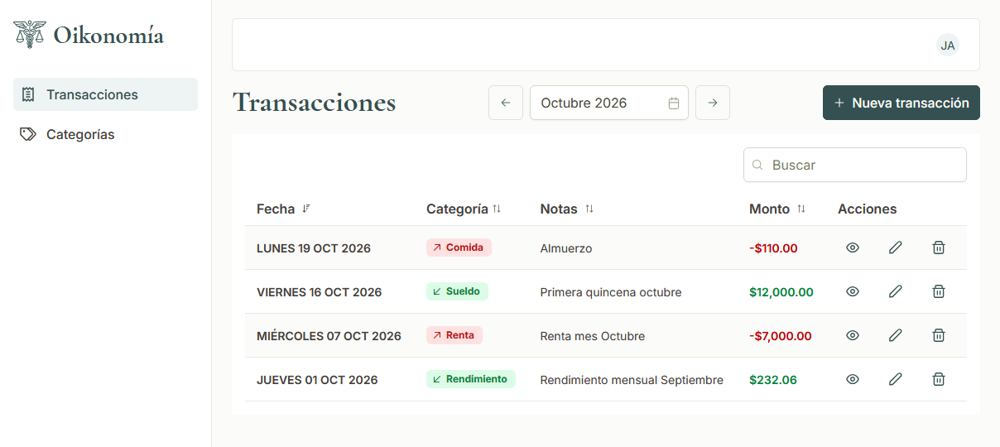
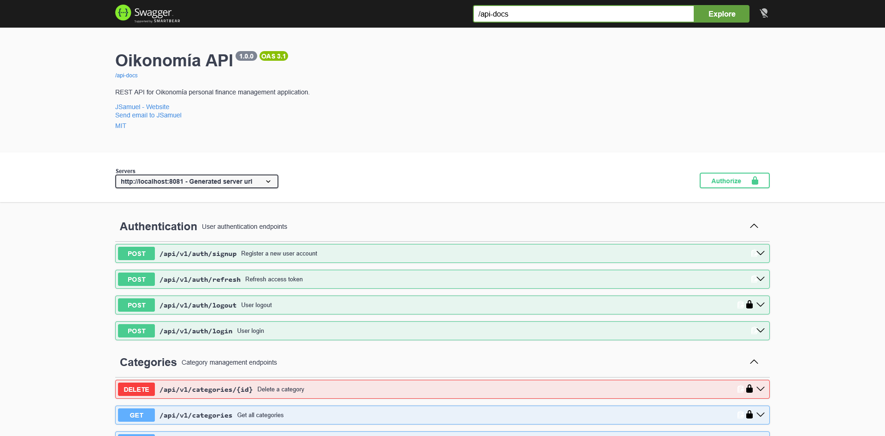

# Oikonomía UI

Aplicación web para llevar el seguimiento de gastos personales. SPA Construida con estructura de feature-based.



## Contenido

- [Sobre el proyecto](#sobre-el-proyecto)
- [Funcionalidades](#funcionalidades)
- [Stack](#stack)
- [Arquitectura](#arquitectura)
- [Estructura del código](#estructura-del-código)
- [Seguridad](#seguridad)
- [Pruebas](#pruebas)
- [Calidad y CI/CD](#calidad-y-cicd)
- [Primeros pasos](#primeros-pasos)
- [Comandos](#comandos)
- [API](#api)
- [Retos técnicos y lecciones aprendidas](#retos-técnicos-y-lecciones-aprendidas)
- [Contacto](#contacto)
- [Licencia](#licencia)

## Sobre el proyecto

Saber cuánto ganas y cuánto gastas es importante. Mi forma de llevar el seguimiento de mis gastos e ingresos consistía
en un Excel con una tabla y gráficos. En un principio era suficiente, pero comenzaron a surgir detalles que me
incomodaban su uso:

- **No era responsivo:** Me resultaba más cómodo utilizarlo en mi computadora.
- **Bugs:** Agregar nuevas categorías producía el típico error de desbordamiento. Constantemente tenía que hacer ajustes
  para soportar un rango mayor de celdas.
- **La tabla crecía**: No podía filtrar las transacciones por mes porque rompía las gráficas y los cálculos.
- **La más importante**: Venció la licencia que me proporcionaba mi universidad. No quería repetir la plantilla en otra
  alternativa.

La mayoría de problemas sencillos se solucionan con una hoja de cálculo (si se sabe hacerlo bien), pero en esta ocasión,
me di cuenta de que tenía un problema real. Era propio, pero serviría para tener un proyecto útil en mi portafolio y
poner en práctica mis habilidades como ingeniero de software.

Actualmente, me estoy concentrando en tener listo un MVP en lugar de tratar de tener el proyecto perfecto. Mi idea es
usar sus funcionalidades básicas, darme cuenta de que le falta, qué sería útil y proponer cambios absurdos (ventajas de
ser mi propio usuario).

También pienso agregar mejoras a la aplicación, como testing, gráficas y optimizaciones y mejoras UX. Así que el
proyecto seguirá recibiendo actualizaciones de todo tipo.

## Funcionalidades

- Registro de usuarios, inicio y cierre de sesión.
- Gestión de categorías de ingresos y gastos.
- Gestión de transacciones por mes.

Pendientes:

- Actualizar categorías.
- Gestión de presupuestos mensuales por categoría.
- Gráficas y estadísticas.

## Stack

### Framework y UI

Angular es mi framework frontend favorito. Es muy completo. Sumado a los componentes de PrimeNG, facilita mucho la
construcción de interfaces.


### Calidad de Código

Estas herramientas me ayudan a mantener código formateado, a detectar posibles bugs y a escribir buenos commits.


### DevOps


## Arquitectura

Con la arquitectura feature-based, las dependencias siguen un solo sentido: Los `features` importan de `shared` y `core`
. shared importa de `core`. `core` nunca importa de `features`.

Aquí no quise complicármela con arquitectura hexagonal. Dudo mucho que llegue el momento de cambiar de dependencias.

### Capas y responsabilidades

- `core`: infraestructura transversal que la aplicación necesita antes de cargar cualquier feature. Maneja autenticación
  , sesión de usuario, guards y tema.
- `shared`: dominio y UI compartido entre features, como pipes y componentes genéricos.
- `layouts`: contenedores de página (`auth-layout` y `main-layout`).
- `features/*`: contiene páginas, componentes y servicios.

## Estructura del código

```text
.
├── .github/
│   ├── actions/configure-environment/   # Genera environment.ts en CI
│   └── workflows/ci.yml
├── nginx/
│   ├── default.conf.template            # SPA, proxy a /api y caché
│   └── security-headers.conf
├── public/                              # Favicons y assets sin hash
├── src/
│   ├── app/
│   │   ├── core/
│   │   │   ├── auth/
│   │   │   ├── user/                    # Perfil del usuario actual
│   │   │   └── theme/                   # Preset de PrimeNG
│   │   ├── shared/
│   │   │   ├── category/                # Modelos, API y CategoryStore (lectura)
│   │   │   ├── models/                  # FlowType y su presentación
│   │   │   ├── pipes/
│   │   │   ├── ui/
│   │   │   └── util/
│   │   ├── layouts/
│   │   │   ├── auth-layout/             # Para las páginas de login y signup
│   │   │   └── main-layout/             # Sidebar y header
│   │   └── features/
│   │       ├── auth/
│   │       ├── categories/
│   │       └── transactions/
│   └── environments/
├── Dockerfile
└── proxy.conf.json                      # Proxy de ng serve hacia la API

```

## Seguridad

### Sesión y autenticación

- El access token vive solo en memoria. Nunca se escribe en `localStorage` ni `sessionStorage`.
- El refresh token viaja en una cookie `httpOnly; Secure; SameSite=Strict` que gestiona el navegador. El frontend no la
  lee ni la guarda.
- La renovación del token es de una sola petición en vuelo (por si dos peticiones al mismo tiempo fallan, solo una llama
  a refresh). El backend rota el refresh token en cada uso y revoca todas las sesiones si detecta reutilización, así que
  dos renovaciones simultáneas habrían cerrado la sesión del usuario.
- Los guards protegen los layouts según el estado de autenticación.
- El logout limpia la sesión y los datos del usuario en memoria aunque la petición al servidor falle.
- El login muestra un mensaje genérico, sin distinguir entre usuario inexistente y contraseña incorrecta.

### Contenedor y despliegue

- El navegador solo habla con un origen: nginx sirve la SPA y reenvía `/api/` a la API. Con el mismo origen no hace
  falta CORS y la cookie `SameSite=Strict` funciona.
- Imagen se construye en dos etapas. La imagen final contiene únicamente nginx y los estáticos, sin Node ni
  `node_modules`.
- nginx corre como usuario sin privilegios (puerto 8080) y con `server_tokens off`.
- Cabeceras de seguridad: `X-Content-Type-Options`, `X-Frame-Options`, `Referrer-Policy` y `Permissions-Policy`. La CSP
  está en modo `Report-Only` mientras se valida que no rompe PrimeNG ni la carga de estilos de Angular.
- Caché: `index.html` nunca se cachea; los bundles con hash y `media/` son inmutables. Un chunk inexistente devuelve 404
  y no `index.html`.
- `npm ci --ignore-scripts` en el build para no ejecutar scripts de dependencias, y `.dockerignore` excluye `.env*`.
- La licencia de PrimeUI no se versiona. En local vive en `environment.local.ts` y en CI se genera `environment.ts`
  desde una variable de entorno de GitHub. Como la licencia se valida en el cliente, la clave forma parte del bundle
  publicado.

## Pruebas

Con cada componente u artefacto que genero, no elimino su archivo de pruebas spec. Actualmente no hay pruebas reales,
pero los mantengo por si en un futuro las incluyo.

Para que las pruebas pasen en CI, tuve que ajustar algunas, como enviar datos obligatorios que esperan con `input` y
simular las peticiones HTTP para que no salgan a una API real. Al final, solo son ajustes que no otorgan valor real en
las pruebas.

## Calidad y CI/CD

El hook `pre-commit` aplica formato con Prettier y ajustes con ESLint. `commit-msg` asegura que el mensaje del commit
siga conventional commits.

Uso un workflow de GitHub Actions en push y pull request a la rama `main`. Un push nuevo cancela la ejecución en curso
de un PR.

- `quality`: valida formato, lint y pruebas.
- `build`: compila en producción. Genera `environment.ts` con la licencia de PrimeUI.
- `docker`: construye la imagen sin publicarla. Comprueba que NGINX inicie correctamente.

La rama `main` no puede recibir commits directamente; deben integrarse mediante pull requests. Incluyo plantillas para
abrir issues y pull requests.

## Primeros pasos

### Requisitos

- Node.js 26 y npm
- API de Oikonomia en ejecución (versión [0.1.0](https://github.com/JSamuelAP/oikonomia-api/releases/tag/v0.1.0))
- Docker (opcional)
- Licencia de PrimeUI (para que no muestre un mensaje de error en la interfaz). Se puede conseguir gratis en
  [primestore](https://primeui.store/primeui)

### Arranque

Clona el repositorio e instala las dependencias:

```bash
npm ci
```

Crea `src/environment/environment.local.ts`:

```ts
export const environment = {
  production: false,
  apiUrl: '',
  primeUiLicense: '<tu-clave>',
};
```

Iniciar servidor de desarrollo:

```bash
npm start
```

La aplicación queda disponible en [http://localhost:4200](http://localhost:4200).

Iniciar con Docker:

```bash
docker build --build-arg BUILD_CONFIGURATION=local -t oikonomia-ui .
docker run --rm -p 8080:8080 -e API_UPSTREAM=http://host.docker.internal:8081 oikonomia-ui
```

### Variables de entorno

| Variable       | Descripción                                          | Valor por defecto |
| -------------- | ---------------------------------------------------- | ----------------- |
| `API_UPSTREAM` | URL interna de la API a la que nginx reenvía `/api/` | `http://api:8081` |

## Comandos

Iniciar servidor de desarrollo con configuración `local` y proxy a la API:

```bash
npm start
```

Compilar producción en `dist/`:

```bash
npm run build
```

Compilar en modo watch (recompila al cambiar archivos):

```bash
npm run watch
```

Ejecutar pruebas en watch mode:

```bash
npm test
```

Ejecutar las pruebas solo una vez. Usado en CI:

```bash
npm run test:ci
```

Análisis estático con ESLint:

```bash
npm run lint
```

Corregir errores de lint automáticamente:

```bash
npm run lint:fix
```

Formatear código con Prettier:

```bash
npm run format
```

Verificar formato con Prettier

```bash
npm run format:check
```

Eliminar imports no utilizados de Angular:

```bash
npm run cleanup:angular
```

## API



[Repositorio](https://github.com/JSamuelAP/oikonomia-api) de la API REST. Construida con Spring Boot 4 y PostgreSQL.

## Retos técnicos y lecciones aprendidas

| Problema                                                             | Causa                                                                                                                                   | Solución                                                                                                                  |
| -------------------------------------------------------------------- | --------------------------------------------------------------------------------------------------------------------------------------- | ------------------------------------------------------------------------------------------------------------------------- |
| El código no puede tener la licencia de PrimeUI pero la necesita     | No es recomendable distribuir la licencia en el código fuente                                                                           | Configuración `local` no versionada. Usar variables de GitHub Actions en CI                                               |
| Renovaciones simultáneas del token cerraban todas las sesiones       | El backend rota el refresh token en cada uso y detecta reutilización; dos `401` a la vez disparaban dos `/refresh`                      | `TokenRefreshService` comparte una única petición en vuelo (`share` + `finalize`) y el interceptor reintenta una sola vez |
| Recargar la página enviaba a `/login` con sesión válida              | El access token solo está en memoria y se pierde al recargar; el guard evalúa antes de cualquier petición                               | Un inicializador de la aplicación refresca el token antes de que el router evalúe los guards                              |
| El formulario de edición no mostraba los valores iniciales           | Los inicializadores de campo se ejecutan en el constructor, antes de que Angular aplique los inputs; `initialValue()` valía `undefined` | El modelo del formulario se siembra con `linkedSignal`, que recalcula cuando llega el input                               |
| El formulario desaparecía antes de terminar la animación del diálogo | Un `@if` sobre el estado destruía el componente al instante, mientras PrimeNG aún animaba el cierre                                     | Estado de render rezagado que se limpia en `onHide`, y el detalle no se monta sin datos                                   |
| La fecha inicial era inválida frente a `maxDate`                     | Dos llamadas a `new Date()` difieren en milisegundos y el valor inicial quedaba después del límite                                      | Una sola fuente: `startOfDay()` para el límite y una copia para el valor inicial                                          |
| El calendario se abría al abrir el diálogo                           | `p-dialog` enfoca el primer control antes de terminar su transición y el `DatePicker` lo interpreta como apertura (un bug de PrimeNG)   | `[focusOnShow]="false"` en el diálogo                                                                                     |
| Los tests se quedaban 10 s en `whenStable()`                         | Un `resource` con la petición sin responder mantiene la aplicación inestable                                                            | Responder cada petición pendiente con `HttpTestingController`                                                             |
| Un texto con solo espacios pasaba `minLength`                        | `minLength` cuenta los espacios                                                                                                         | Validador `notBlank`, que solo actúa si hay contenido (para no duplicar el mensaje de `required`), y `trim()` al enviar   |
| `semantic.secondary` no compila en el tema                           | `semantic` tiene una forma fija en Aura; solo `primitive` admite paletas nuevas                                                         | Paletas propias en `primitive` y referencias por token desde `semantic`                                                   |

## Contacto

[](https://www.linkedin.com/in/jsamuelap/)

[](https://github.com/JSamuelAP)

[](mailto:sp4619168@gmail.com)

## Licencia

El código fuente de este proyecto está licenciado bajo la licencia [MIT](https://choosealicense.com/licenses/mit/).

Todos los recursos visuales (logotipos, imágenes, capturas de pantalla, marca personal) NO están cubiertos por esta
licencia y no pueden reutilizarse sin permiso explícito.
